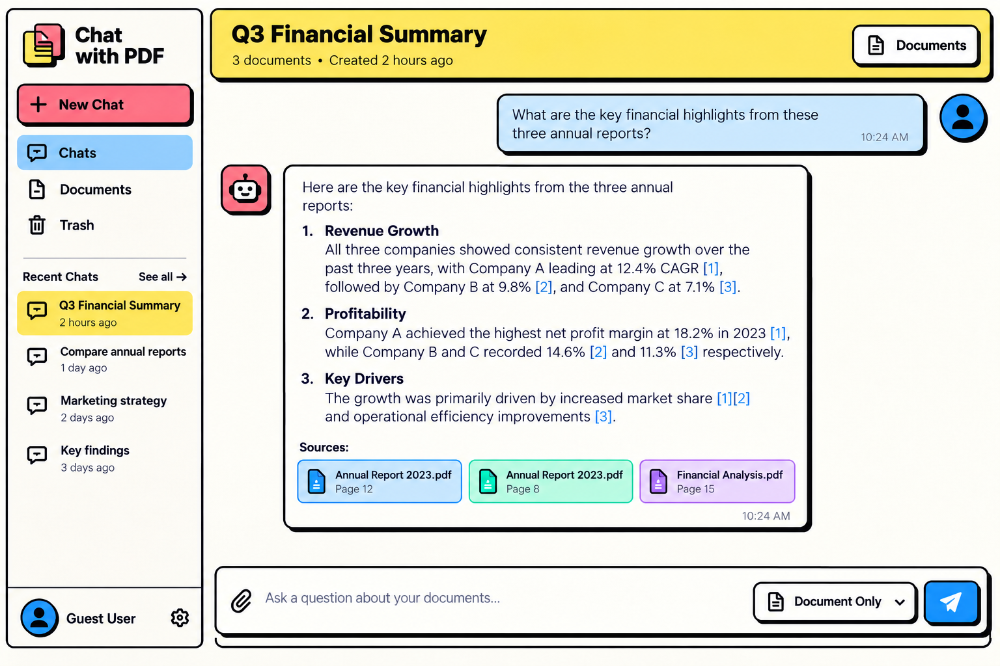
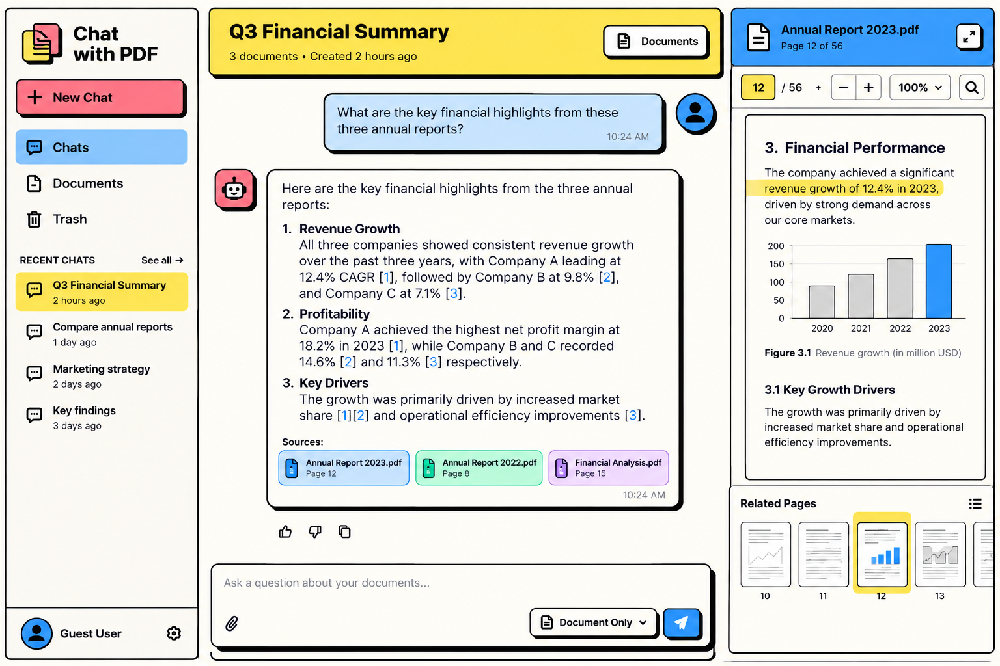
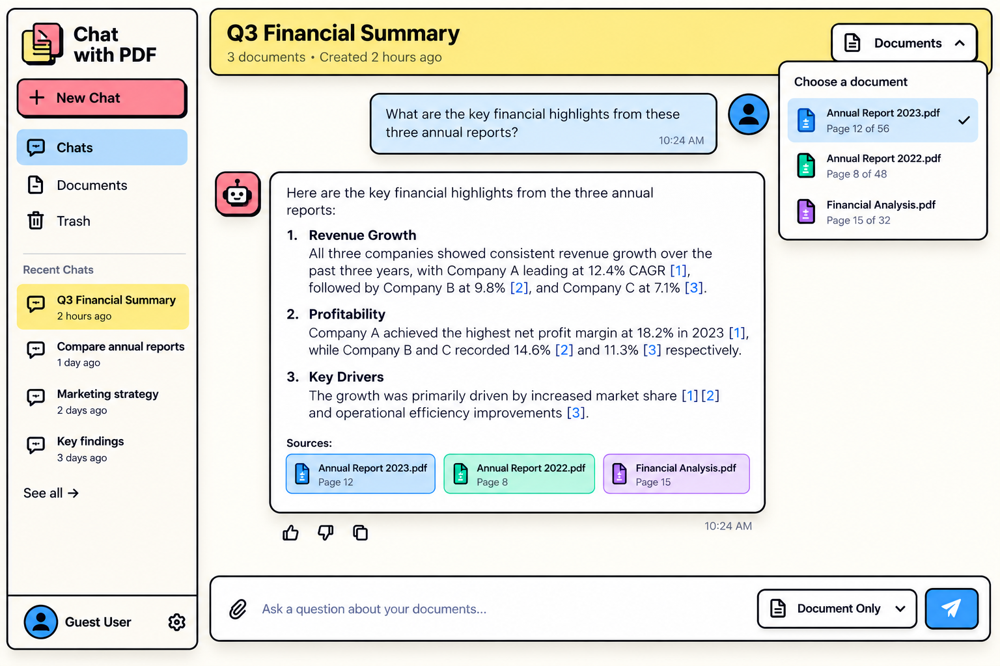
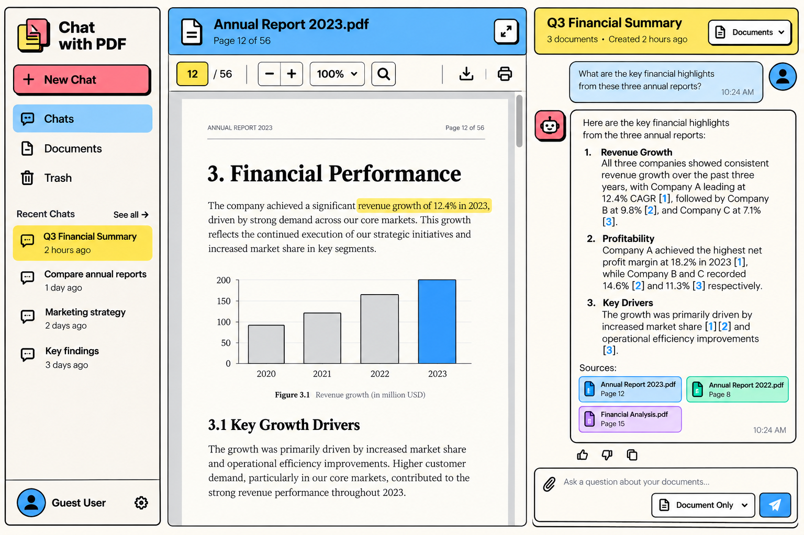
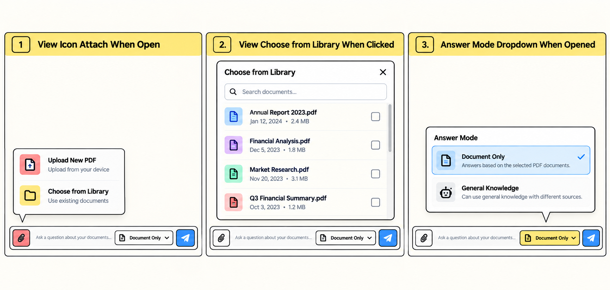
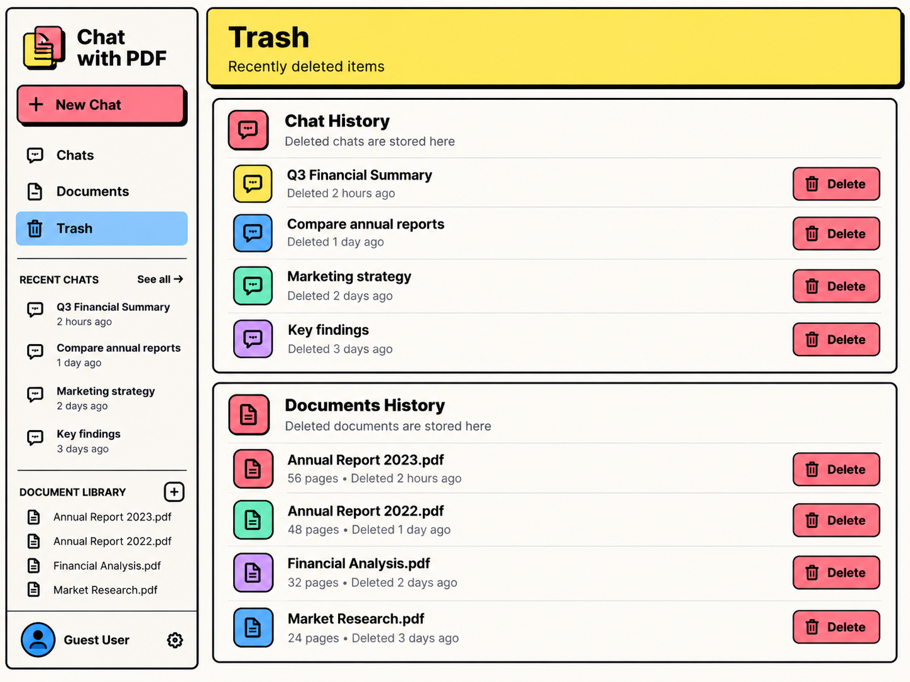
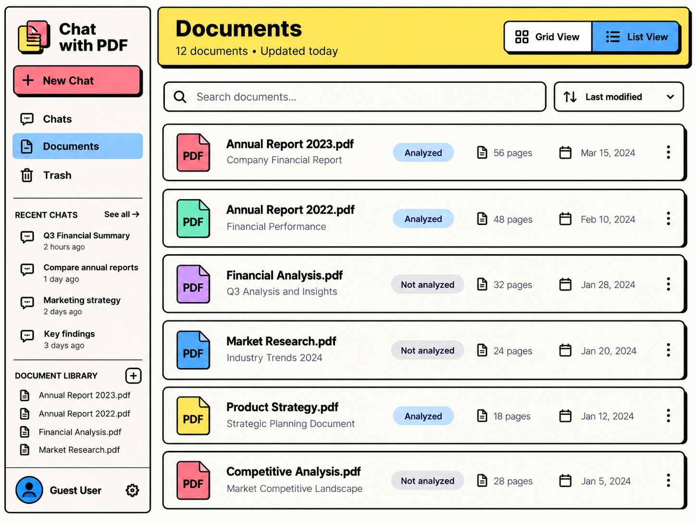
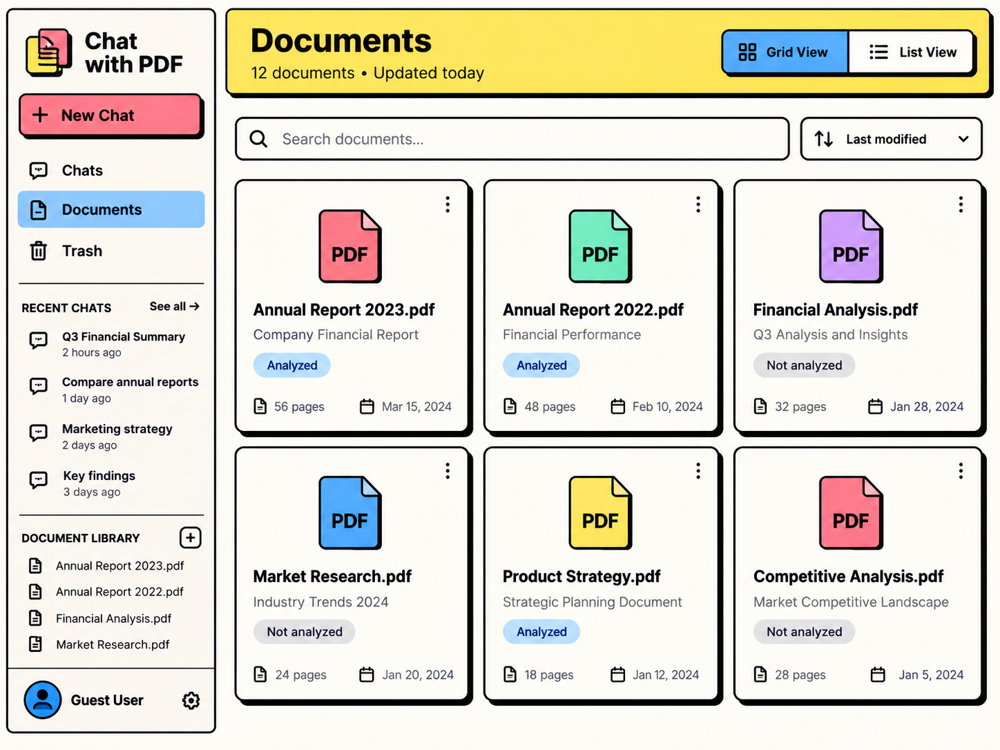

# Frontend Implementation — Chat with PDF

## Execution Scope — Monorepo Root

Codex dijalankan dari **root project** yang memiliki folder `docs/`, `frontend/`, dan `backend/`. **Seluruh instalasi dependency, command, konfigurasi, perubahan source code, dan testing aplikasi hanya boleh dilakukan di `frontend/`**. Jangan mengubah, memindahkan, menghapus, atau menjalankan perubahan apa pun di `backend/`. Dokumentasi implementasi disimpan di **root** `docs/prompt/` dan `docs/res/` (bukan `frontend/docs/`). Gunakan working directory `frontend/` saat menjalankan command frontend.

## Objective

Implementasikan seluruh tampilan **Chat with PDF** berdasarkan mockup yang disediakan ke dalam frontend yang sudah ada. Fokus pada konsistensi visual, komponen reusable, dan kesiapan integrasi backend nantinya.

Gunakan **gambar pertama (Landing Page)** sebagai **referensi desain utama** untuk warna, ukuran, border, shadow, spacing, dan gaya komponen. Gambar lainnya adalah referensi layout, interaksi, dan state. Jika terdapat inkonsistensi antar-mockup karena dihasilkan AI, ikuti gaya gambar pertama.

## Screen References

> **Catatan:** Masukkan gambar mockup secara manual di bawah masing-masing heading. Placeholder ini sengaja dikosongkan.

### 1. Landing Page — Main Screen (Primary Design Reference)



### 2. Chat — Document Preview Opened



### 3. Chat — Documents Dropdown Opened



### 4. Chat — Expanded PDF Preview



### 5. Chat — Attachment & Answer Mode Actions



### 6. Trash Screen



### 7. Documents Screen — List View



### 8. Documents Screen — Grid View



## UI & Interaction Requirements

- Implementasikan **Chats, Documents, dan Trash** beserta tampilan dan interaksi yang terlihat di referensi.
- Sidebar berisi navigasi, recent chats, dan account section. **Jangan tambahkan Document Library di sidebar**, meskipun muncul pada beberapa mockup.
- Chat mendukung tampilan pesan user/assistant, sumber dokumen, pemilihan dokumen, lampiran, serta pilihan **Document Only / General Knowledge**.
- Bubble chat user harus tetap **menempel di sisi kanan** area chat. Dropdown/popover harus tampil sebagai **overlay** dan **tidak menggeser bubble atau layout chat**; overlay boleh menutupi bubble maupun icon user.
- Document preview mendukung panel di samping chat dan tampilan yang diperbesar, dengan kontrol PDF mengikuti referensi.
- Documents menyediakan pencarian, sorting, serta toggle **Grid / List**. Trash mengikuti struktur dan aksi yang tampak pada mockup.
- Implementasikan **responsive desktop, tablet, dan mobile**. Jadikan desktop mockup sebagai referensi utama; adaptasikan sidebar menjadi drawer/sheet, area chat, PDF preview, toolbar, dropdown, dan grid dokumen agar nyaman dipakai di layar kecil. Hindari horizontal overflow dan jangan mengubah karakter visual desktop.

## Component & Styling Rules

- Gunakan **shadcn/ui** sebagai basis komponen. Baca [dokumentasi resminya](https://ui.shadcn.com/docs/components), **install komponen yang dibutuhkan terlebih dahulu**, lalu **modifikasi komponen shadcn yang terpasang** (base component, theme tokens, dan variants bersama) agar hasilnya mengikuti mockup, bukan mempertahankan tampilan default shadcn.
- Utamakan UI **minimalis dan konsisten**. Karena gambar dibuat AI, variasi kecil shadow, border, radius, spacing, atau sizing antar-screen **bukan alasan membuat komponen atau props styling baru**. Gunakan satu shared Button, satu shared Dropdown, dan primitive lain yang sama untuk seluruh screen.
- Perbedaan visual yang benar-benar bermakna (misalnya warna/semantic intent atau ukuran yang memang diperlukan) boleh menggunakan **variants terbatas dan reusable**, bukan custom properties/kelas unik untuk tombol di screen A, B, dan C. Jangan overengineer styling.
- Jangan membuat implementasi Button, Dropdown, Dialog, dan primitive UI lain dari awal jika tersedia di shadcn/ui.
- Definisikan styling dan variants yang dipakai berulang **di base/root component atau shared styling**, bukan menyalin CSS ke setiap halaman.
- Pertahankan kode existing yang masih relevan. Hindari rewrite atau refactor di luar kebutuhan implementasi.

## Data Fetching, Mock API & PDF Preview

- Install dan gunakan **TanStack Query v5** untuk server state (`useQuery`/`useMutation`) dan **Axios** sebagai HTTP client bersama. Seluruh request dari UI harus melalui `hooks/` dan `services/`, bukan memanggil mock handler secara langsung.
- Konfigurasi **MSW** untuk mengintersep request Axios dan mengembalikan mock response yang type-safe. Backend nyata dan business logic produksi **tidak perlu dibuat**. Gunakan in-memory mock data secukupnya agar flow UI bisa dicoba, termasuk state loading, empty, error, dan success.
- Pisahkan mock handlers, fixtures, endpoint definitions, types, dan API services. Pertahankan kontrak request/response yang konsisten agar nanti MSW dapat diganti backend tanpa rewrite komponen.
- Untuk `send chat`, gunakan `multipart/form-data` (message dan file dokumen opsional); untuk edit chat gunakan message saja. Feedback AI response memakai endpoint tersendiri.
- Untuk delete, bedakan soft delete dan hard delete secara eksplisit pada route/parameter API. Dokumentasikan kontrak yang dipilih; jangan membuat dua operasi berbeda dengan path/method identik tanpa pembeda.
- Sediakan folder **`public/pdfs/`** yang awalnya kosong (boleh berisi `.gitkeep`) untuk file PDF yang akan ditambahkan manual.
- Atur contoh data mock agar PDF preview membaca file berdasarkan **nama file dari `public/pdfs/`**. Dokumentasikan nama file yang diharapkan; setelah file PDF ditaruh dengan nama tersebut, preview harus dapat berfungsi **tanpa perubahan kode**.
- Gunakan viewer PDF yang sesuai untuk fitur preview, navigasi halaman, dan kontrol yang terlihat pada mockup. Saat file contoh belum tersedia, tampilkan fallback yang jelas tanpa membuat aplikasi crash.

## Mock Endpoint Scope

Implementasikan **mock API contract, Axios service, TanStack Query integration, dan MSW handlers** untuk endpoint berikut. Tidak perlu membuat backend maupun business logic produksi.

### Feedback

- `POST` feedback terhadap AI response.

### Chats

- `POST` send chat — multipart (`message` + dokumen).
- `POST` edit chat — message only (mengikuti metode yang diminta).

### Sessions

- `GET` all sessions.
- `GET` chats by session.
- `GET` all deleted sessions.
- `PATCH` rename session.
- `DELETE` soft delete session.
- `DELETE` hard delete session.
- `POST` restore session.

### Documents

- `GET` all uploaded documents.
- `GET` documents by session.
- `GET` deleted documents.
- `DELETE` soft delete document.
- `DELETE` hard delete document.
- `POST` restore document.

Pilih path REST yang konsisten dan dokumentasikan method, path, payload/params, serta contoh response secara ringkas di `docs/res/`. Endpoint tambahan boleh dibuat bila dibutuhkan untuk menjalankan mock UI, tetapi **wajib dicatat dan diberi alasan** di dokumentasi. Jangan membuat fitur atau business logic baru di luar kebutuhan UI.

## Folder Structure

Seluruh path aplikasi di bawah ini relatif terhadap `frontend/`, **kecuali `docs/` yang berada di root repository**.

Ikuti struktur berikut dan pertahankan folder existing yang sudah sesuai:

```text
app/          — routing, page, layout; page cukup merender master component
components/   — shared UI dan komponen per fitur/screen
hooks/        — custom React hooks
services/     — API request / komunikasi backend
providers/    — global providers (mis. query, theme, MSW)
types/        — TypeScript types dan interfaces
lib/          — konfigurasi dan helper utama
utils/        — utility kecil
styles/       — global styling
mocks/        — MSW handlers dan dummy data
../docs/prompt/ — prompt implementasi (root repository)
../docs/res/    — laporan implementasi dan dokumentasi mock API (root repository)
public/pdfs/  — tempat file PDF manual
```

Kelompokkan komponen fitur berdasarkan screen, misalnya `chat/`, `documents/`, dan `trash/`. Jangan memenuhi `app/page.tsx` dengan detail UI dan business logic.

## Engineering Rules

- Tulis TypeScript secara **type-safe**; hindari penggunaan `any`.
- Terapkan standar engineering dan UI/UX setara developer profesional berpengalaman.
- Gunakan abstraction secukupnya: reusable ketika diperlukan, tanpa overengineering.
- Hindari perubahan yang merusak fitur existing. Verifikasi navigasi, dropdown, layout, mock request, dan PDF preview.
- Pastikan build/lint/test yang tersedia tetap berjalan; tambahkan atau sesuaikan test untuk perilaku yang diimplementasikan.

## Documentation & Implementation Log

Buat struktur dokumentasi berikut di **root repository** (di luar `frontend/`):

```text
docs/
  prompt/   — file Markdown instruksi implementasi ini
  res/      — hasil pekerjaan, API contract, dan implementation log
```

Simpan prompt ini di `docs/prompt/`. Di `docs/res/`, catat:

1. Ringkasan fitur/perubahan yang dibuat (singkat).
2. Daftar dependency yang diinstall beserta **seluruh command terminal instalasi yang benar-benar dijalankan** (termasuk shadcn/ui, TanStack Query, Axios, MSW, PDF viewer). Tidak perlu menyalin output terminal.
3. Daftar seluruh mock endpoint (method, path, payload/params, contoh response), termasuk **endpoint tambahan dan alasannya**.
4. Folder/file penting, cara menjalankan MSW, dan cara menggunakan API mock melalui Axios + TanStack Query.
5. Cara menaruh PDF dalam `public/pdfs/`, nama file yang diharapkan, dan cara mencoba preview.
6. Hasil validasi desktop/mobile, lint/build/test, serta keterbatasan yang masih ada.

## Definition of Done

Seluruh screen dan interaksi utama dapat dicoba menggunakan Axios + TanStack Query + MSW; seluruh endpoint dalam scope memiliki handler mock dan terdokumentasi; layout responsive pada desktop dan mobile; desain konsisten dengan **gambar pertama**, komponen shadcn dapat digunakan ulang, dropdown tidak menggeser chat, sidebar tidak memiliki Document Library, dan PDF preview berjalan setelah file PDF yang sesuai ditempatkan dalam `frontend/public/pdfs/` tanpa perlu mengubah source code. Seluruh perubahan aplikasi terbatas pada `frontend/`, dokumentasi pada root `docs/`, dan `backend/` tetap tidak tersentuh.
